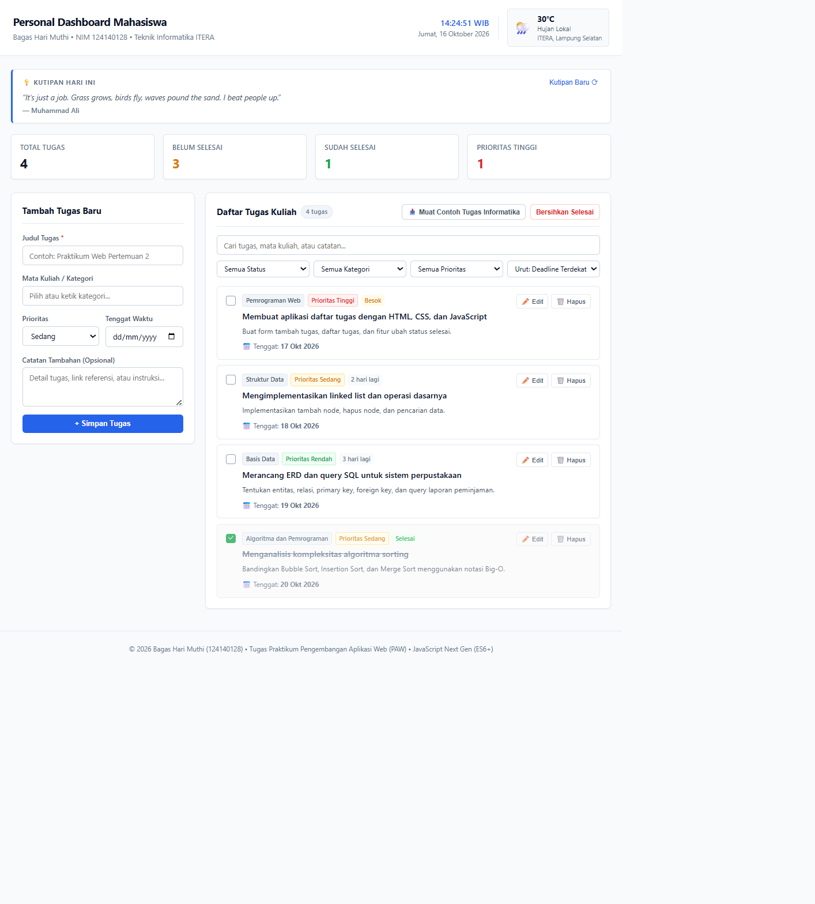

# Personal Dashboard Mahasiswa

Aplikasi **Personal Dashboard Mahasiswa** berbasis web yang dibangun dengan standar modern **JavaScript Next Gen (ES6+)**. Aplikasi ini dirancang khusus untuk memenuhi kebutuhan organisasi dan manajemen akademik mahasiswa (jadwal tugas kuliah, prioritas, tenggat waktu, catatan, serta widget cuaca kampus realtime dan kutipan motivasi harian).

> **Identitas Mahasiswa:**  
> Nama: **Bagas Hari Muthi**  
> NIM: **124140128**  
> Program Studi: **Teknik Informatika - Institut Teknologi Sumatera (ITERA)**  
> Mata Kuliah: **Praktikum Pengembangan Aplikasi Web (Pertemuan 2)**

---

## Deskripsi Aplikasi

Aplikasi ini menyajikan dasbor terpadu untuk membantu mahasiswa mengelola beban tugas kuliah secara terstruktur dan efisien. 

### Fitur Utama:
1. **Manajemen Tugas Lengkap (CRUD):**
   - **Tambah Tugas (Create):** Menambahkan tugas baru dilengkapi judul, mata kuliah/kategori, tingkat prioritas (Tinggi, Sedang, Rendah), tanggal tenggat waktu (deadline), dan catatan tambahan.
   - **Tampilkan & Saring (Read):** Menampilkan daftar tugas dengan badge prioritas, sisa hari menuju deadline (Hari ini, Terlambat X hari, Besok, dsb.), filter status (Semua / Belum Selesai / Selesai), filter mata kuliah, filter prioritas, dan pencarian instan (search).
   - **Sunting Tugas (Update):** Modal interaktif untuk mengubah data tugas yang sudah tersimpan, serta checklist langsung untuk menandai tugas telah selesai.
   - **Hapus Tugas (Delete):** Menghapus tugas individual dengan dialog konfirmasi, atau membersihkan seluruh tugas yang telah selesai sekaligus (*Clear Completed*).
2. **Penyimpanan Lokal Persisten (`localStorage`):**
   - Seluruh perubahan data tugas disimpan otomatis ke `localStorage` sehingga data tetap utuh ketika halaman dimuat ulang (*refresh*).
3. **Statistik Produktivitas Real-time:**
   - Ringkasan cepat jumlah total tugas, tugas aktif (belum selesai), tugas selesai, dan tugas berprioritas tinggi.
4. **Integrasi API Eksternal Publik (Async/Await):**
   - **Widget Cuaca Kampus Real-time:** Memanggil Open-Meteo Public API untuk koordinat kampus ITERA (Lampung Selatan: `-5.36, 105.31`) menampilkan suhu, kondisi langit, dan ikon cuaca terkini.
   - **Kutipan Motivasi Harian:** Memanggil DummyJSON Quotes API secara asinkron untuk memberikan motivasi belajar harian kepada mahasiswa.
   - **Contoh Tugas Informatika (Seed Data):** Memuat contoh tugas Pemrograman Web, Struktur Data, Basis Data, dan Algoritma dan Pemrograman.
5. **Desain Bersih & Fungsional (Clean UI/UX):**
   - Mengusung tampilan antarmuka yang bersih, minimalis, rapi, dan nyaman dibaca tanpa gradien berlebihan atau elemen dekoratif semu (tidak tampak seperti *template* AI generik).

---

## Screenshot Antarmuka



---

## Fitur ES6+ yang Diimplementasikan

Berikut adalah daftar implementasi fitur modern JavaScript (ES6+) yang digunakan dalam proyek ini beserta lokasi file dan baris kodenya:

| No | Fitur ES6+ | File Sumber | Baris Kode | Deskripsi Implementasi |
|:--:|---|---|:--:|---|
| 1 | `const` dan `let` | `js/modules/DashboardApp.js` | 5–6, 51 | Konstanta konfigurasi dan variabel penghitung migrasi seed lama |
| 2 | **Arrow Functions** (minimal 3) | `js/modules/TaskItem.js` | 25, 29, 37 | Method `toggleDone`, `isOverdue`, dan `getDeadlineStatus` |
| | | `js/modules/DashboardApp.js` | 44, 67, 75, 97, 112, 193 | Operasi load/save, CRUD, filtering, dan pemuatan tugas contoh |
| 3 | **Template Literals** | `js/modules/TaskItem.js` | 52, 60 | Membentuk label status tenggat secara dinamis |
| | | `js/app.js` | 177–213 | Merender kartu tugas secara dinamis dari state |
| 4 | **Fungsi Asinkron** (`async/await`) | `js/modules/weatherApi.js` | 44–77 | Mengambil cuaca Open-Meteo dengan fallback saat offline |
| | | `js/modules/quoteApi.js` | 23–47 | Mengambil kutipan DummyJSON dengan fallback lokal |
| | | `js/app.js` | 92–141 | Memuat dan menampilkan data cuaca serta kutipan |
| 5 | **Classes** (OOP) | `js/modules/TaskItem.js` | 4–62 | `class TaskItem` untuk data dan perilaku tugas |
| | | `js/modules/DashboardApp.js` | 34–214 | `class DashboardApp` untuk state dan penyimpanan tugas |
| 6 | **Destructuring** | `js/modules/TaskItem.js` | 5–14 | Destructuring parameter constructor |
| | | `js/modules/DashboardApp.js` | 75 | Destructuring parameter `addTask` |
| | | `js/modules/weatherApi.js` | 55–56 | Destructuring respons cuaca |
| 7 | **Spread Operator** (`...`) | `js/modules/DashboardApp.js` | 57, 92, 102–103, 114, 203, 210 | Menyalin objek dan memperbarui array state secara immutable |
| 8 | **Default Parameters** | `js/modules/TaskItem.js` | 5–14 | Nilai default untuk properti tugas |
| | | `js/modules/DashboardApp.js` | 75, 97 | Nilai default kategori, prioritas, dan objek perubahan |
| | | `js/app.js` | 52, 64 | Nilai default notifikasi dan tanggal |
| 9 | **Modern Array Methods** | `js/modules/DashboardApp.js` | 53, 99, 112, 124, 130, 136, 140, 146–149, 157, 180, 196 | Penggunaan `.map()`, `.filter()`, `.find()`, dan `.sort()` |
| 10 | **ES Modules** (`import` / `export`) | `js/app.js` | 3–5 | Mengimpor modul dashboard, cuaca, dan kutipan |
| | | `js/modules/TaskItem.js`, `js/modules/DashboardApp.js`, `js/modules/weatherApi.js`, `js/modules/quoteApi.js` | 4, 34, 44, 23 | Mengekspor class dan fungsi agar dapat digunakan antarmodul |

---

## Struktur Berkas Proyek

```
bagasharimuthi_124140128_pertemuan2/
├── index.html                   # Halaman utama aplikasi (struktur semantik HTML5)
├── style.css                    # Lembar gaya CSS (desain bersih, responsif, minimalis)
├── script.js                    # Pengarah alternatif ke modul utama
├── js/
│   ├── app.js                   # Entry point aplikasi & pengendali DOM (DOM Controller)
│   └── modules/
│       ├── TaskItem.js          # Class model data TaskItem
│       ├── DashboardApp.js      # Class DashboardApp (state & localStorage)
│       ├── weatherApi.js        # Modul asinkron cuaca kampus ITERA (Open-Meteo)
│       └── quoteApi.js          # Modul asinkron kutipan motivasi (DummyJSON)
├── screenshots/
│   └── main.png                 # Tangkapan layar antarmuka aplikasi berjalan
├── docs/
│   ├── tugas-personal-dashboard.md        # Panduan tugas praktikum
│   └── javascript-nextgen-es6-context.md  # Materi referensi ES6+
└── README.md                    # Dokumentasi lengkap proyek
```

---

## Cara Menjalankan Aplikasi

Karena proyek ini menggunakan fitur **JavaScript ES Modules** (`type="module"`), browser menerapkan kebijakan keamanan *CORS* yang memblokir pemuatan modul jika dibuka langsung melalui protokol `file://`.

Oleh karena itu, aplikasi **wajib dijalankan melalui web server lokal**:

### Menggunakan VS Code Live Server (Direkomendasikan):
1. Buka folder proyek ini di **Visual Studio Code**.
2. Pastikan ekstensi **Live Server** (oleh Ritwick Dey) sudah terpasang di VS Code.
3. Klik kanan pada berkas `index.html`.
4. Pilih **"Open with Live Server"** (atau tekan tombol *Go Live* di sudut kanan bawah).
5. Aplikasi akan otomatis terbuka di browser pada alamat `http://127.0.0.1:5500/index.html`.

### Alternatif Menggunakan Python:
Jalankan perintah berikut di terminal pada direktori proyek:
```bash
python -m http.server 8080
```
Buka browser dan akses alamat: `http://localhost:8080`
