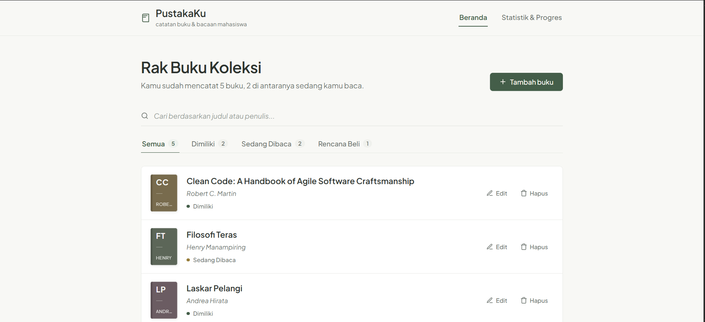
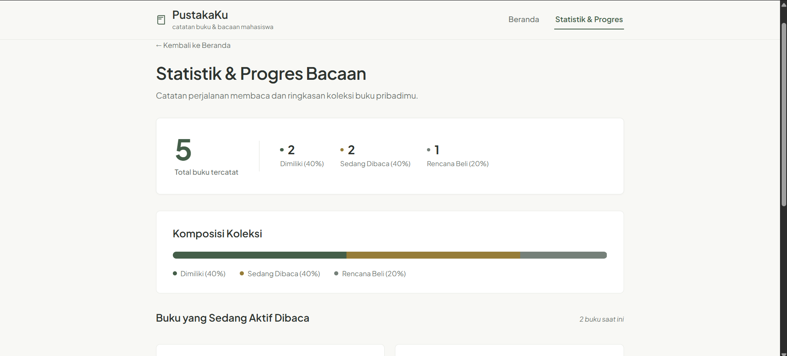
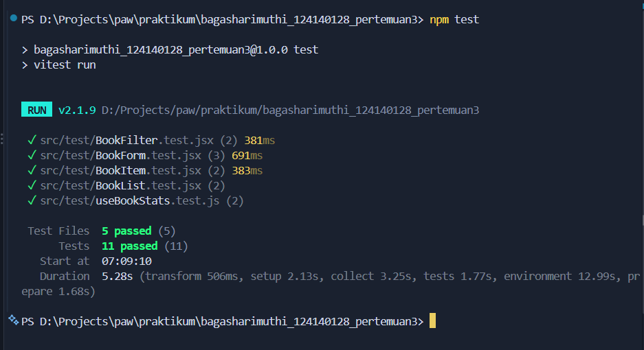

# Aplikasi Manajemen Buku Pribadi (PustakaKu)

Aplikasi web modern berbasis **React.js** untuk mencatat, mengelola, dan memantau progres koleksi buku pribadi mahasiswa. Pengguna dapat mengorganisasi buku berdasarkan status kepemilikan dan bacaan (**dimiliki**, **sedang dibaca**, dan **rencana dibeli**), melakukan pencarian instan, menyaring kategori, serta memantau statistik progres bacaan secara terstruktur.

> **Identitas Mahasiswa:**  
> Nama: **Bagas Hari Muthi**  
> NIM: **124140128**  
> Program Studi: **Teknik Informatika - Institut Teknologi Sumatera (ITERA)**  
> Mata Kuliah: **Praktikum Pengembangan Aplikasi Web (Pertemuan 3 - React.js)**

---

## 1. Deskripsi Fitur

1. **Manajemen Koleksi Buku (CRUD Lengkap):**
   - **Tambah Buku:** Menambahkan buku baru dengan atribut Judul, Nama Penulis, dan Status (`milik`, `baca`, `beli`).
   - **Edit Buku:** Mengubah informasi buku yang sudah tersimpan melalui formulir interaktif dengan tombol *Simpan Perubahan* dan opsi *Batal*.
   - **Hapus Buku:** Menghapus buku dari daftar dengan konfirmasi modal dialog yang aman dan informatif.
2. **Pencarian & Penyaringan Fleksibel:**
   - **Pencarian Real-time:** Mencari buku secara cepat berdasarkan kecocokan kata kunci pada **judul** atau **nama penulis**.
   - **Filter Status:** Menyaring tampilan buku berdasarkan status: *Semua*, *Dimiliki*, *Sedang Dibaca*, atau *Rencana Beli*.
3. **Penyimpanan Persisten (`localStorage`):**
   - Data buku disimpan otomatis ke dalam `localStorage` browser menggunakan *custom hook* dengan *lazy initial state*, sehingga data tetap aman dan tidak hilang ketika halaman dimuat ulang (*refresh*).
4. **Halaman Statistik & Progres Bacaan:**
   - Halaman khusus (`/stats`) yang menampilkan rekapitulasi jumlah total buku, persentase buku yang dimiliki, rasio buku yang sedang dibaca, buku rencana beli, serta daftar cepat buku yang sedang aktif dibaca.
5. **Validasi Form & Visual Feedback:**
   - Validasi kolom wajib diisi (*required fields*) dengan pembersihan spasi (*trim*). Jika input kosong, formulir memberikan *feedback* visual langsung berupa bingkai merah (`input-error`) dan pesan peringatan di bawah kolom terkait.
6. **Desain Bersih & Fungsional (Non-AI Look):**
   - Tata letak dirancang rapi, proporsional, nyaman digunakan, responsif untuk berbagai ukuran layar (*mobile friendly*), dan menggunakan palet warna profesional tanpa efek animasi atau gradien berlebihan.

---

## 2. Struktur Proyek

```text
bagasharimuthi_124140128_pertemuan3/
├── public/
│   └── book-icon.svg             # Favicon aplikasi
├── src/
│   ├── components/               # Komponen UI reusable (dilengkapi PropTypes & CSS modular)
│   │   ├── BookForm/             # Form input & edit buku (segmented control & validasi visual)
│   │   │   ├── BookForm.jsx
│   │   │   └── BookForm.css
│   │   ├── BookList/             # Kontainer rak, sampul kanvas, & kartu baris buku
│   │   │   ├── BookList.jsx
│   │   │   ├── BookItem.jsx
│   │   │   ├── BookCover.jsx
│   │   │   ├── BookCover.css
│   │   │   └── BookList.css
│   │   ├── BookFilter/           # Baris cari underline & tab status bergaris aksen
│   │   │   ├── BookFilter.jsx
│   │   │   └── BookFilter.css
│   │   ├── Drawer/               # Panel geser samping (Slide-over drawer form)
│   │   │   ├── Drawer.jsx
│   │   │   └── Drawer.css
│   │   ├── Navbar/               # Header wordmark serif & garis bawah aktif
│   │   │   ├── Navbar.jsx
│   │   │   └── Navbar.css
│   │   ├── StatCard/             # Kartu metrik statistik
│   │   │   ├── StatCard.jsx
│   │   │   └── StatCard.css
│   │   └── ConfirmModal/         # Dialog modal reusable untuk konfirmasi hapus
│   │       ├── ConfirmModal.jsx
│   │       └── ConfirmModal.css
│   ├── pages/                    # Halaman navigasi aplikasi
│   │   ├── Home/                 # Halaman utama (Koleksi & Form Buku)
│   │   │   ├── Home.jsx
│   │   │   └── Home.css
│   │   ├── Stats/                # Halaman statistik & progres bacaan
│   │   │   ├── Stats.jsx
│   │   │   └── Stats.css
│   │   └── NotFound/             # Halaman 404 jika rute tidak ditemukan
│   │       ├── NotFound.jsx
│   │       └── NotFound.css
│   ├── hooks/                    # Custom Hooks React
│   │   ├── useLocalStorage.js    # Sinkronisasi state ke localStorage (lazy initialization)
│   │   └── useBookStats.js       # Penghitungan rekapitulasi status buku teroptimasi
│   ├── context/                  # State Management Global
│   │   └── BookContext.jsx       # Context API Provider & Hook useBooks()
│   ├── test/                     # Unit Testing (Vitest + React Testing Library)
│   │   ├── BookForm.test.jsx
│   │   ├── BookItem.test.jsx
│   │   ├── BookFilter.test.jsx
│   │   ├── BookList.test.jsx
│   │   └── useBookStats.test.js
│   ├── App.jsx                   # Routing dan pembungkus Context Provider
│   ├── App.css
│   ├── main.jsx                  # Entry point aplikasi React
│   ├── index.css                 # Gaya global & reset layout
│   └── setupTests.js             # Konfigurasi matchers jest-dom
├── index.html                    # Berkas HTML utama
├── vite.config.js                # Konfigurasi Vite & Vitest environment jsdom
├── package.json                  # Dependensi dan scripts
├── .gitignore                    # Mengabaikan node_modules, dist, logs
└── README.md                     # Dokumentasi resmi proyek
```

---

## 3. Fitur React yang Digunakan

| No | Fitur React | Lokasi Implementasi | Penjelasan |
|:--:|---|---|---|
| 1 | **`useState` & `useEffect`** | `BookForm.jsx`, `Home.jsx`, `useLocalStorage.js`, `ConfirmModal.jsx` | Mengelola data input form, status pencarian, sinkronisasi storage, dan pendengar event tombol *Escape*. |
| 2 | **Context API (`BookContext`)** | `src/context/BookContext.jsx` | Menyediakan *single source of truth* untuk state data buku global (`books`, `addBook`, `updateBook`, `deleteBook`, `resetToSample`) tanpa *prop drilling*. |
| 3 | **React Router (`react-router-dom`)** | `App.jsx`, `Navbar.jsx`, `Stats.jsx`, `NotFound.jsx` | Navigasi SPA multi-halaman dengan rute `/` (Beranda), `/stats` (Statistik), dan `*` (Halaman 404 Not Found) menggunakan `BrowserRouter`, `Routes`, `Route`, dan `NavLink`. |
| 4 | **Custom Hooks (2 Hooks)** | `src/hooks/useLocalStorage.js`<br>`src/hooks/useBookStats.js` | `useLocalStorage` menangani persistensi storage secara lazy; `useBookStats` menghitung total dan distribusi status menggunakan `useMemo`. |
| 5 | **Reusable Components** | `BookForm`, `BookList`, `BookItem`, `BookFilter`, `Navbar`, `ConfirmModal`, `StatCard` | Komponen modular yang dapat dipakai ulang di berbagai tempat dengan konfigurasi props yang jelas. |
| 6 | **PropTypes Validation** | **Seluruh komponen** di folder `components/`, `pages/`, dan `context/` | Memastikan tipe data props valid pada masa pengembangan untuk mencegah *runtime error*. |
| 7 | **Immutability State** | `BookContext.jsx` | Seluruh manipulasi state buku menggunakan `spread operator`, `.map()`, dan `.filter()`, tidak melakukan mutasi langsung (`push`/`splice`). |

---

## 4. Panduan Instalasi & Menjalankan

Pastikan telah menginstal **Node.js** (rekomendasi versi 18 ke atas) dan **npm** di komputer Anda.

### 4.1 Langkah Instalasi

```bash
# 1. Buka terminal dan masuk ke folder proyek
cd bagasharimuthi_124140128_pertemuan3

# 2. Pasang seluruh dependensi proyek
npm install
```

### 4.2 Menjalankan Mode Pengembangan (Development)

```bash
npm run dev
```
Setelah server Vite berjalan, buka peramban (*browser*) pada alamat:
`http://localhost:5173`

### 4.3 Menjalankan Unit Test

Untuk menjalankan seluruh unit test yang telah dibuat:
```bash
npm test
```

### 4.4 Membuat Versi Produksi (Build)

```bash
npm run build
```

---

## 5. Hasil Unit Testing

Pengujian otomatis dibangun menggunakan **Vitest** dan **React Testing Library**:

1. **`BookForm.test.jsx`**:
   - Menampilkan pesan error validasi visual saat form disubmit dengan kolom kosong.
   - Memanggil `onSubmit` dengan payload data buku yang benar ketika input valid.
   - Memuat data lama dan mengubah label tombol menjadi "Simpan Perubahan" pada mode edit.
2. **`BookItem.test.jsx`**:
   - Memastikan judul, nama penulis, dan badge status ter-render sesuai properti.
   - Memastikan tombol Edit dan Hapus memicu *callback* yang bersangkutan.
3. **`BookFilter.test.jsx`**:
   - Memverifikasi *event handler* pencarian teks judul/penulis terpanggil.
   - Memverifikasi pergantian filter chip status.
4. **`useBookStats.test.js`**:
   - Menghitung jumlah total buku dan pemisahan status (*milik*, *baca*, *beli*) secara akurat.
   - Menangani kasus saat data buku masih kosong (`[]`).
5. **`BookList.test.jsx`**:
   - Menampilkan elemen status kosong saat tidak ada buku.
   - Merender deretan kartu buku secara akurat saat ada data.

---

## 6. Tangkapan Layar Antarmuka Aplikasi

### 6.1 Halaman Beranda (Daftar Rak Buku & Navigasi)
Tampilan antarmuka beranda dengan tata letak rak buku bergaya alami, pencarian instan, filter tab berangka status, indikator titik status, dan sampul kanvas minimalis:



### 6.2 Halaman Statistik & Progres Bacaan
Tampilan ringkasan metrik hero besar, distribusi status stacked bar horizontal, progres halaman buku yang aktif dibaca, serta kutipan inspirasi membaca:



---

## 7. Laporan Hasil Pengujian (Unit Test)

Pengujian otomatis dijalankan menggunakan **Vitest** dan **React Testing Library**. Seluruh 11 skenario pengujian pada 5 berkas test suite berhasil dieksekusi dengan status **PASSED (100% lulus)** tanpa peringatan:



```text
 RUN  v2.1.9 D:/Projects/paw/praktikum/bagasharimuthi_124140128_pertemuan3

 ✓ src/test/useBookStats.test.js (2 tests)
 ✓ src/test/BookList.test.jsx (2 tests)
 ✓ src/test/BookFilter.test.jsx (2 tests)
 ✓ src/test/BookItem.test.jsx (2 tests)
 ✓ src/test/BookForm.test.jsx (3 tests)

 Test Files  5 passed (5)
      Tests  11 passed (11)
```

